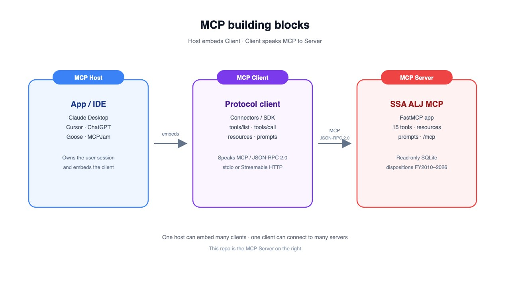
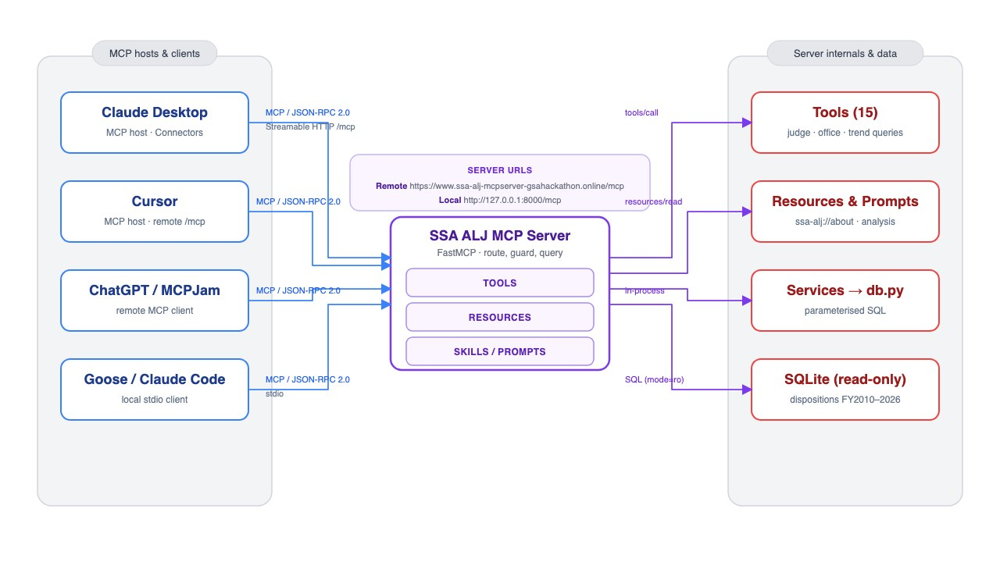
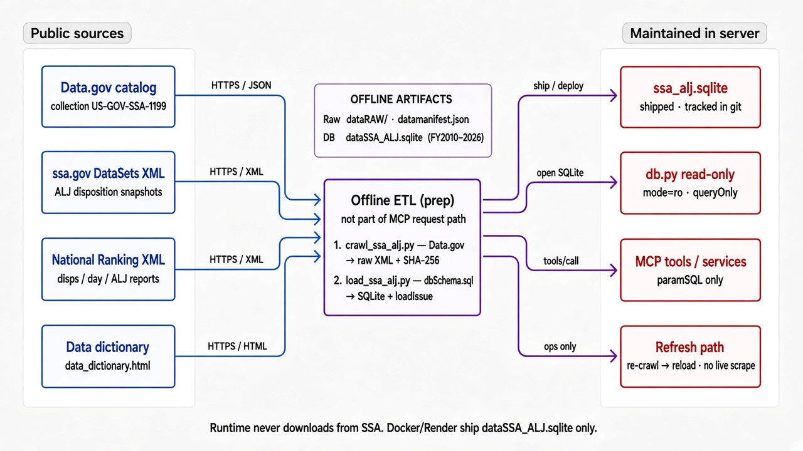

# `data/` — SSA ALJ open data cache

This folder holds the **public** Social Security Administration (SSA) Office of Hearings
Operations Administrative Law Judge (ALJ) disposition files used by the MCP server, plus the
SQLite database the server reads at runtime.

## Purpose

SSA publishes disposition counts as many separate XML snapshots listed in the
[Data.gov ALJ Disposition Data collection](https://catalog.data.gov/?q=ALJ+Disposition+Data&sort=last_harvested_date&collection=US-GOV-SSA-1199&results=400)
(`US-GOV-SSA-1199`). Those files are cumulative fiscal-year-to-date, schemas drift over time,
office names change, and there is no stable judge ID.

This directory exists so the MCP server can answer questions from a **local, read-only SQLite
database** instead of scraping live XML on every tool call. Agents never need to know the XML
layout or FYTD semantics.

Contents here are **aggregate public statistics** (judge names as published). There is no
claimant PII.

**Live server using this dataset:** [https://www.ssa-alj-mcpserver-gsahackathon.online/](https://www.ssa-alj-mcpserver-gsahackathon.online/)  
MCP endpoint: `https://www.ssa-alj-mcpserver-gsahackathon.online/mcp`

**Project docs:** [Architecture](../docs/ARCHITECTURE.md) · [Demo walkthrough](../docs/demo/demo.md)

## Diagrams

Same diagrams as [ARCHITECTURE.md](../docs/ARCHITECTURE.md). MCP Host → Client → Server roles:



MCP hosts → FastMCP server → read-only SQLite:



Offline crawl/load builds `ssa_alj.sqlite`; the MCP server only reads it:



## Layout

| Path | Role |
|---|---|
| `raw/` | Downloaded SSA XML (and the data-dictionary HTML), mirroring paths from the [Data.gov ALJ Disposition Data collection](https://catalog.data.gov/?q=ALJ+Disposition+Data&sort=last_harvested_date&collection=US-GOV-SSA-1199&results=400) |
| `raw/archive/03_FY####/` | Historical ALJ disposition snapshots by federal fiscal year |
| `raw/archive/04_FY####/` | National Ranking (“dispositions per day per ALJ”) reports when present |
| `manifest.json` | Crawl inventory: URL → local path, HTTP status, size, SHA-256 (gitignored; regenerated by crawl) |
| `ssa_alj.sqlite` | Built database the MCP server opens read-only (`SSA_ALJ_DB_PATH`) |
| [`db/schema.sql`](db/schema.sql) | SQLite tables and views used by the loader and the MCP server |
| [`scripts/`](scripts/) | Offline ETL + MCP client demo (`crawl_ssa_alj.py`, `load_ssa_alj.py`, `mcp_client_demo.py`) |

Schema and views for the database live in [`db/schema.sql`](db/schema.sql).

## How the data is obtained

Offline ETL only (not part of the MCP runtime):

1. **Crawl** — [`scripts/crawl_ssa_alj.py`](scripts/crawl_ssa_alj.py)
   - Lists child datasets for Data.gov collection `US-GOV-SSA-1199`
   - Downloads each XML (and SSA’s data-dictionary page) into `raw/`
   - Writes/updates `manifest.json` with status, bytes, and SHA-256
   - Sequential requests with delay; resumable (skips files already OK unless `--force`)

2. **Load** — [`scripts/load_ssa_alj.py`](scripts/load_ssa_alj.py)
   - Reads files listed in `manifest.json`
   - Detects report type from row field names
   - Loads into `ssa_alj.sqlite` using [`db/schema.sql`](db/schema.sql)
   - Idempotent by SHA-256; anomalies go to a `load_issue` table instead of being silently dropped

```bash
uv run --group etl data/scripts/crawl_ssa_alj.py    # ~minutes; resumable
uv run data/scripts/load_ssa_alj.py                 # writes / refreshes ssa_alj.sqlite
```

### Crawl permission

This collection is **public open data** on Data.gov (`US-GOV-SSA-1199`). Automated use is
aligned with that publication model:

- **Data.gov catalog** [`robots.txt`](https://catalog.data.gov/robots.txt) allows crawlers and
  asks for `Crawl-Delay: 10`.
- **ssa.gov** [`robots.txt`](https://www.ssa.gov/robots.txt) does **not** disallow
  `/appeals/DataSets/` for `User-Agent: *`, so the published XML paths are not robots-blocked.
- In practice SSA’s CDN often returns **403** to plain scripted clients. That is bot protection,
  not a robots.txt ban. The crawl script stays polite (sequential requests, delay/backoff) and
  uses browser TLS impersonation (`curl_cffi`) only so the published files can be fetched.
- Listing uses the **Data.gov catalog API**; file bytes come from the SSA URLs the catalog
  points to. The MCP server never crawls at request time.

`robots.txt` is guidance, not a full legal opinion; check SSA / Data.gov terms for formal reuse.

## How it is maintained

- **Refresh from SSA:** re-run crawl (optionally `--force`), then load. Prefer keeping both
  `raw/` and `ssa_alj.sqlite` in sync so Docker/Render and local clones match.
- **Do not edit XML by hand.** Treat `raw/` as a mirror of the public site; fix parsing in the
  load script if something is wrong.
- **Runtime:** the MCP process only **reads** `ssa_alj.sqlite` (`mode=ro`, `PRAGMA query_only`).
  It does not download from SSA.
- **Git:** `raw/` and `ssa_alj.sqlite` are tracked so clones and container builds work without a
  crawl. `manifest.json` is gitignored and recreated by the crawler. Docker builds still exclude
  `raw/` from the image (`.dockerignore`) and copy only `ssa_alj.sqlite`.

## Important semantics (for consumers)

- Counts are **fiscal-year-to-date** (federal FY Oct–Sep). The September snapshot is the full year.
- Allowance / denial rates are **not** case-mix adjusted and are not performance ratings.
- Always prefer figures that carry the report **as-of** / period-end date from the database.

## Provenance

| Item | Source |
|---|---|
| Publisher | SSA Office of Hearings Operations |
| Catalog | https://catalog.data.gov/?q=ALJ+Disposition+Data&sort=last_harvested_date&collection=US-GOV-SSA-1199&results=400 |
| Dictionary | `raw/data_dictionary.html` (from SSA) |
| Schema | [`db/schema.sql`](db/schema.sql) |
