# Demo — SSA ALJ Open Data MCP

Short walkthrough for judges and presenters. Full architecture: [ARCHITECTURE.md](../ARCHITECTURE.md).  
Judging map: [JUDGE_CRITERIA.md](../../JUDGE_CRITERIA.md).  
**Presentation deck (PPTX):** [SSA-ALJ-MCP-Hackathon-Deck.pptx](SSA-ALJ-MCP-Hackathon-Deck.pptx)  
**Evaluation document (DOCX):** [SSA-ALJ-MCP-Evaluation-Document.docx](SSA-ALJ-MCP-Evaluation-Document.docx)  
Rebuild both from the official sample templates: `uv run --with python-pptx --with python-docx python docs/demo/build_deck.py`

## Live URLs

| What | URL |
|---|---|
| Landing page | [https://www.ssa-alj-mcpserver-gsahackathon.online/](https://www.ssa-alj-mcpserver-gsahackathon.online/) |
| MCP endpoint (streamable HTTP) | `https://www.ssa-alj-mcpserver-gsahackathon.online/mcp` |
| Health (JSON) | `https://www.ssa-alj-mcpserver-gsahackathon.online/health` |

Open the landing page first — it shows the MCP URL (copy button; **no trailing slash**), health URL, and architecture (Claude Desktop / ChatGPT / MCPJam → FastMCP · 15 tools → SQLite FY 2010–2026). Point clients at `/mcp`.

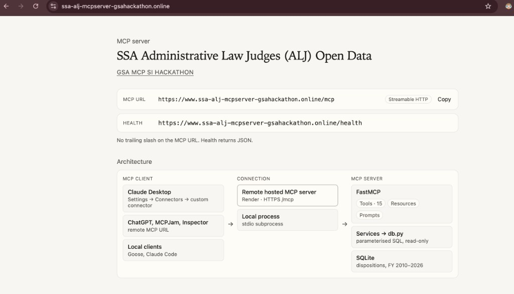

## Open Claude Desktop

Primary live-client path for this demo: **Claude Desktop** with the SSA ALJ MCP server attached (stdio locally, or remote `/mcp` if configured). Full client setup: [LOCAL_STDIO_SETUP.md](../LOCAL_STDIO_SETUP.md).

1. Launch **Claude Desktop** on your Mac.
2. You should see the home chat screen (greeting + “How can I help you today?”).

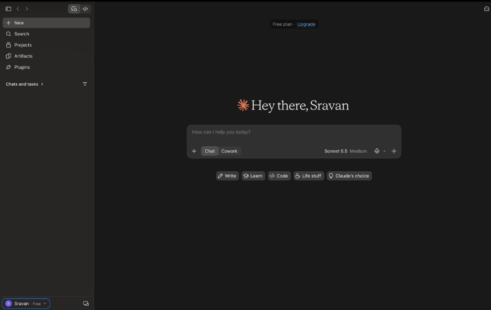

3. Open the account menu (bottom-left profile, e.g. **Sravan · Free**) and choose **Settings** (`⌘,`).

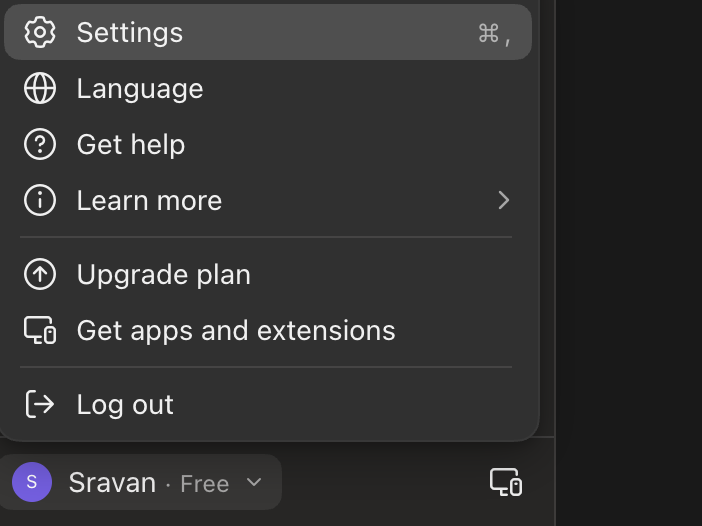

4. Open **Plugins** (sidebar). Under **Your plugins** you may already see **ssa-alj** (`Local MCP server`). To add or reconfigure: click **Add** → **Add custom connector**.

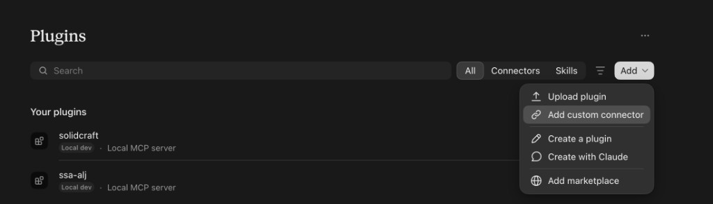

5. In **Add custom connector**, set a **Name** and the live **MCP URL**, then **Continue**:

   | Field | Value |
   |---|---|
   | Name | `SSA-ALJ-MCP-SERVER` |
   | Remote MCP server URL | `https://www.ssa-alj-mcpserver-gsahackathon.online/mcp` |

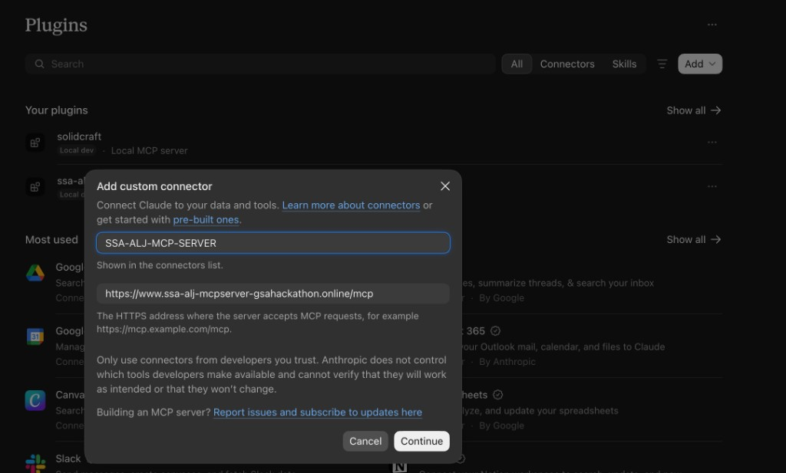

6. On the next screen, leave authentication as **No sign-in** (Detected — this hackathon server has no auth). Leave **Request headers** empty. Click **Add** (do not choose “Sign in now / when needed”).

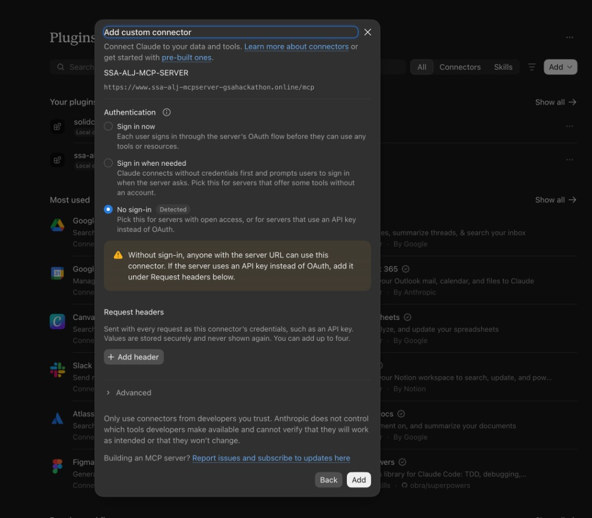

7. Confirm success: the connector shows **✓ Added** / **✓ Connected**, URL `…/mcp`, **No sign-in required**, and read-only tools (e.g. `ssa_alj_business_queries`, `ssa_alj_compare_offices`, … — **Show all 15**).

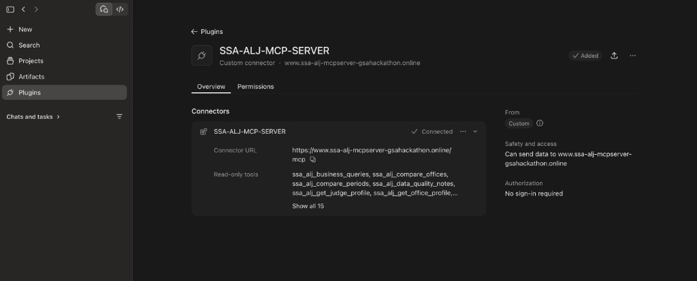

8. Return to the **first chat / home** screen (“How can I help you today?”). Click the **+** button next to the composer → **Plugins**.

9. **Enable the toggle** for the MCP server you just added — **SSA-ALJ-MCP-SERVER** (blue **On**). Leave other local connectors (e.g. `solidcraft`, `ssa-alj`) off unless you need them. Expanding the server shows prompts/resources: **Compare office outcomes**, **Judge summary**, **About**.

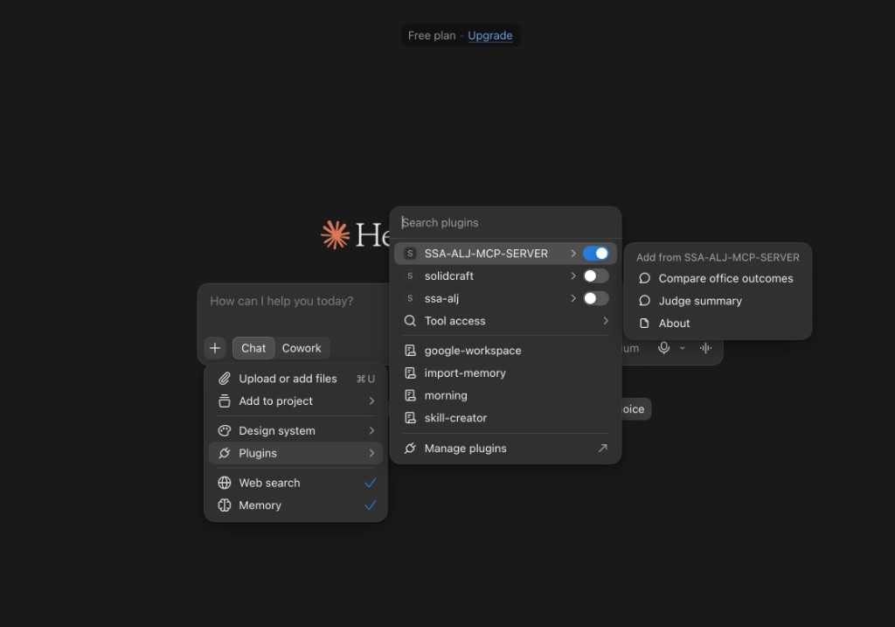

10. **First prompt test (smoke):** in the composer, send:

> use SSA-ALJ-MCP-SERVER, give tools/list

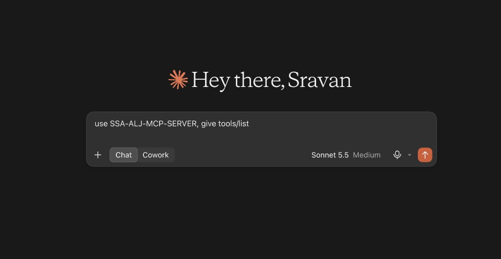

11. **Result:** Claude searches available tools and returns the **15** SSA ALJ tools (grouped, e.g. Coverage and discovery / Offices), noting optional `response_format` (`json` | `markdown`).

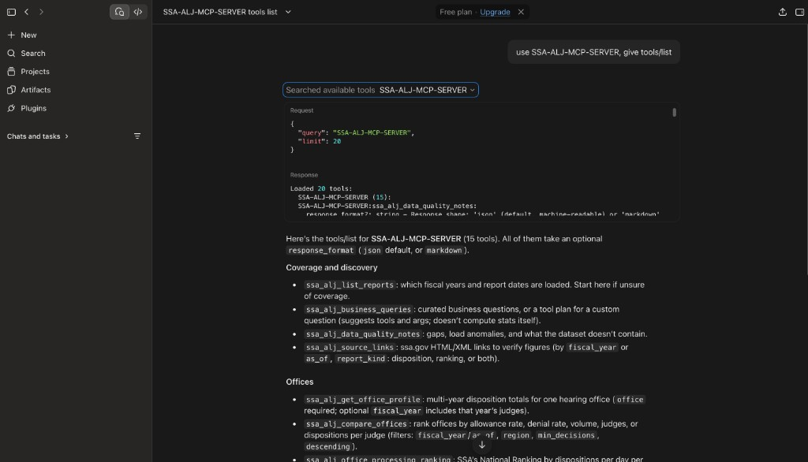

12. **Next prompt:** ask for curated example questions (hits `ssa_alj_business_queries`):

> use SSA-ALJ tools, give me some example asks

Claude will request tool approval (**Needs your input** / **Needs approval**). Choose **Allow once** (`⌘↩`) or **Always allow** (`⇧⌘↩`) so the tool can run.

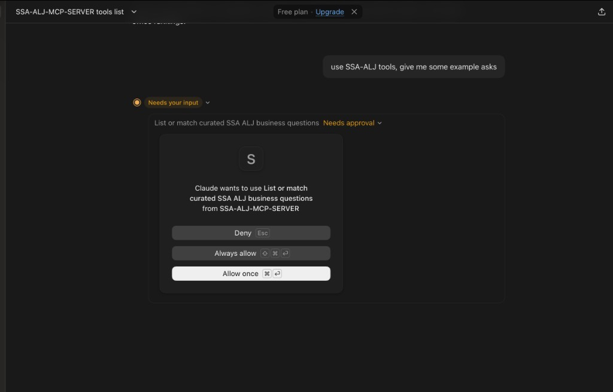

13. **Result:** after approval, `ssa_alj_business_queries` returns curated example asks (coverage, offices, judges, trends, ranking) with suggested tool names — e.g. peak national allowance year → `ssa_alj_national_trend`, Miami top judge → `ssa_alj_within_office_variation`.

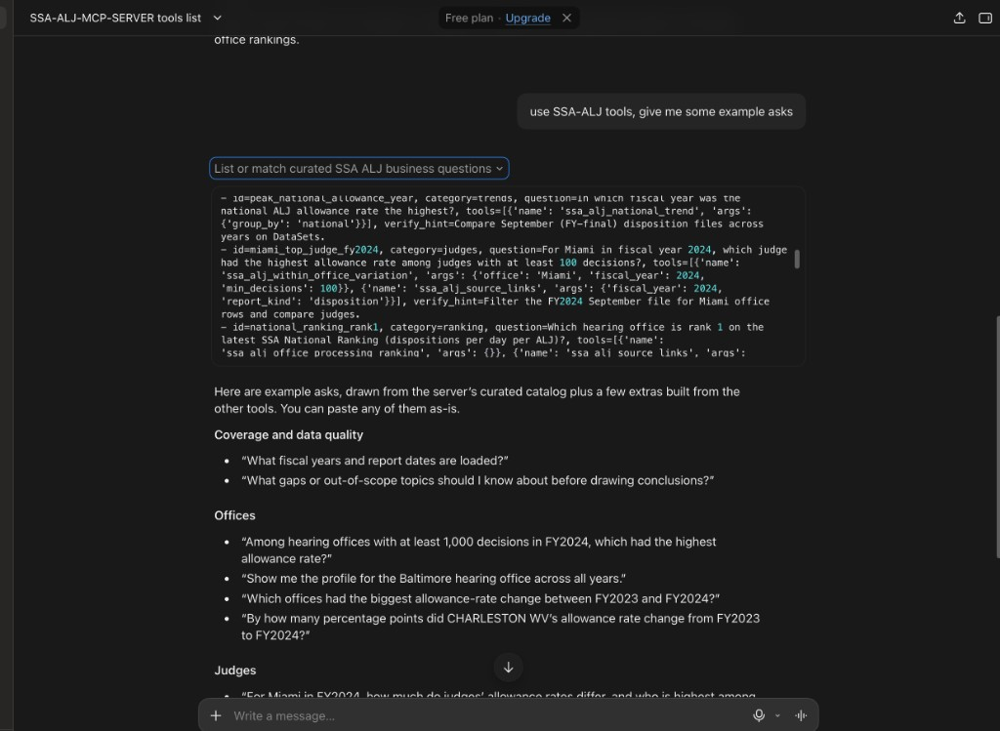

14. **Pick a query from the tool’s suggested asks** (or a short factual follow-up). Demo pick:

> What was the national allowance rate for FY2024?

Claude requests approval for **Multi-year national or regional disposition series** (`ssa_alj_national_trend`). Choose **Allow once** or **Always allow**.

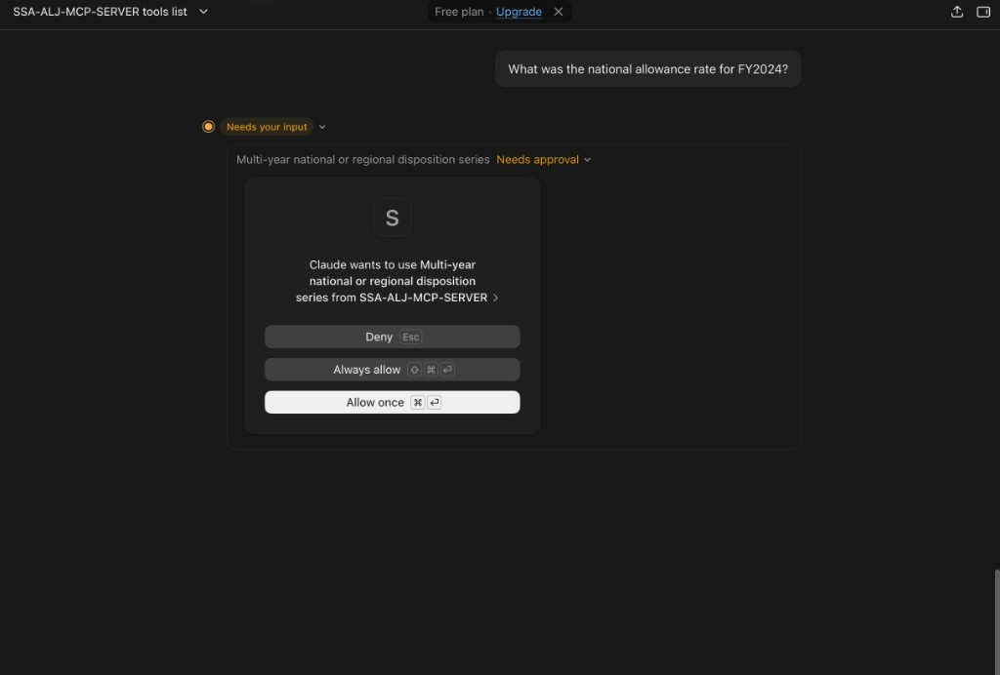

15. **Result (live MCP):** after approval, `ssa_alj_national_trend` runs with `group_by=national`, `from_fiscal_year=2024`, `to_fiscal_year=2024` (markdown). Claude reports **national allowance rate FY2024 ≈ 58.42%** (354,588 decisions; 422,679 dispositions; ~1,221 judges), notes other dispositions / not case-mix adjusted, and can offer `ssa_alj_source_links` next.

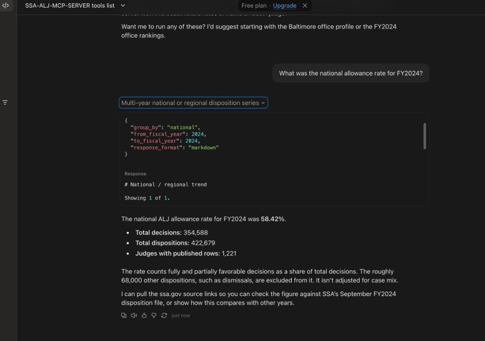

16. Optionally continue with other [sample prompts](#sample-prompts-copy-paste) (office compare, source links, refusal).

For a local stdio connector instead of the remote URL, see [LOCAL_STDIO_SETUP.md](../LOCAL_STDIO_SETUP.md) § Claude Desktop.

## Suggested demo flow (~5 minutes)

1. **Problem (30s)** — SSA publishes ALJ disposition XML as many FYTD snapshots (Data.gov `US-GOV-SSA-1199`). Schemas drift; no judge ID; models should not scrape this alone.
2. **Solution (30s)** — Read-only MCP over local SQLite: 15 tools, `ssa-alj://about`, two prompts. Agents call goals (`compare_offices`, `source_links`), not raw XML.
3. **Open Claude Desktop (30s)** — Home screen as above; MCP connected. Optional: browser landing page / `curl …/health`.
4. **Tool calls (2–3 min)** — In Claude, run the sample prompts below and expand tool results.
5. **Evidence (1 min)** — Point at [eval/RESULTS.md](../../eval/RESULTS.md) (gold + screenshots) and [eval/sdk/RESULTS.md](../../eval/sdk/RESULTS.md) (optional SDK). Caveat: rates are not case-mix adjusted / not performance ratings.

## Sample prompts (copy-paste)

**First smoke (tools/list)**

> use SSA-ALJ-MCP-SERVER, give tools/list

**Example asks (business_queries)**

> use SSA-ALJ tools, give me some example asks

Approve the tool when Claude prompts (**Allow once** or **Always allow**).

**Picked follow-up (national trend)**

> What was the national allowance rate for FY2024?

Approve `ssa_alj_national_trend` when prompted.

**Coverage / discovery**

> What fiscal years of SSA ALJ disposition data does this server cover, and what is the as-of date for FY2024?

**Office comparison (lookup)**

> For fiscal year 2024, which hearing offices have the highest and lowest allowance rates among offices with at least 1000 decisions? Cite the as-of date.

**Verification**

> Give me the official SSA HTML and XML links so I can verify the FY2024 disposition snapshot on ssa.gov.

**Caveat / refusal (guardrails)**

> Which judge will have the best allowance rate next year after adjusting for case mix?

Expect: no invented forecast range; points at quality notes / business queries; reminds that rates are not performance ratings.

## Local demo (optional)

```bash
uv sync
uv run pytest -q
MCP_TRANSPORT=streamable-http uv run ssa-alj-mcp
# another terminal:
curl http://127.0.0.1:8000/health
uv run python data/scripts/mcp_client_demo.py --url http://127.0.0.1:8000/mcp
```

stdio clients: [LOCAL_STDIO_SETUP.md](../LOCAL_STDIO_SETUP.md) · ChatGPT remote: [CHATGPT_SETUP.md](../CHATGPT_SETUP.md) · Docker: [DOCKER_SMOKE.md](../DOCKER_SMOKE.md).

## What to emphasize

- **MCP-shaped tools** (user goals), not thin REST wrappers over each XML file.
- **FYTD semantics** encoded in the server (September = full year; don’t sum snapshots).
- **Verification** via `ssa_alj_source_links` / `snapshot.sources`.
- **Public data only**; read-only SQLite; no claimant PII.

## MCPJam ChatGPT test for MCP Server

Same live server exercised in [MCPJam](https://app.mcpjam.com/) **Playground** (ChatGPT / agent host) against **SERVERS: SSA-ALJ-MCP**.

1. Connect the playground to `https://www.ssa-alj-mcpserver-gsahackathon.online/mcp`.
2. Confirm the Tools pane lists all **15** SSA ALJ tools.
3. Prompt: `give me list of tools SSA ALJ MCP` — agent returns the full tool set (`list_reports` … `data_quality_notes`).

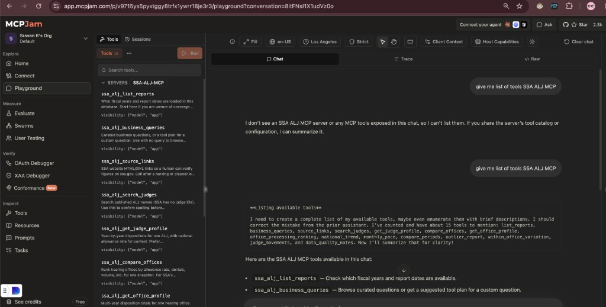

4. Prompt: `give me business queries to check SSA ALJ MCP Server` — agent calls `ssa_alj_business_queries` and returns curated recipes (Coverage, Offices, Trends, Judges, Ranking), e.g. FY2024 top office allowance, national rate, Miami top judge.

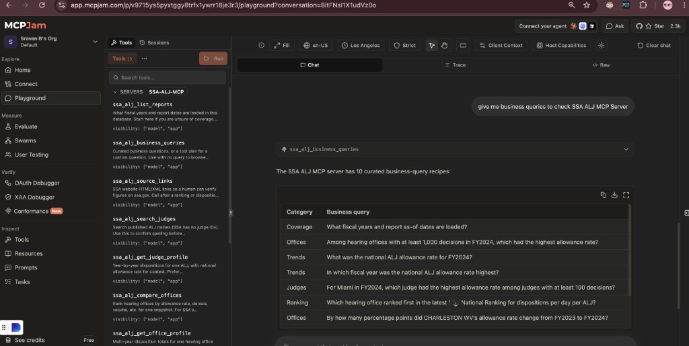

5. Prompt from a recipe: `Use SSA ALJ MCP tools, and find out What fiscal years and report as-of dates are loaded?` — agent calls `ssa_alj_list_reports` and reports coverage **FY2010–FY2026** (e.g. latest FY2026 as of 2026-09-25) with a fiscal-year / report-date table.

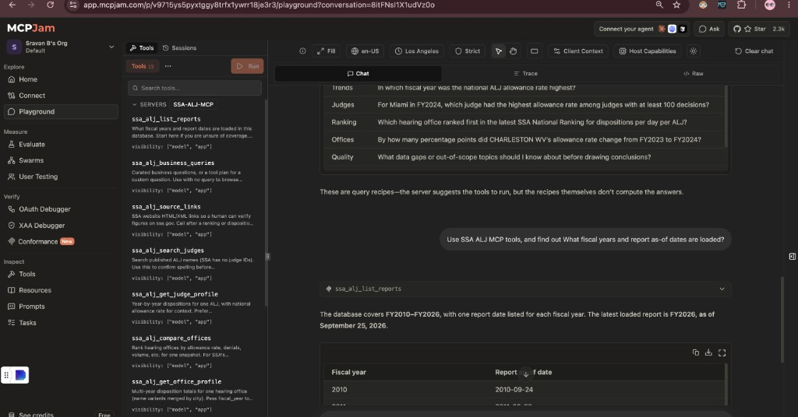

### MCP Server exposed resources

In MCPJam **Inspect → Resources** (server **SSA-ALJ-MCP**), the server exposes:

| Resource | URI | Role |
|---|---|---|
| `about` | `ssa-alj://about` | Data dictionary and caveats (markdown): measures (`allowance_rate`, decisions vs dispositions), FYTD time rules, tool groups (discovery / lookup / analysis) |

`resources/list` + `resources/read` succeed over HTTP `/mcp` (see request log in the screenshot).


### DB schema

Runtime data lives in read-only SQLite (`data/ssa_alj.sqlite`), defined by:

- Schema / views: [`data/db/schema.sql`](../../data/db/schema.sql)
- Data layout & provenance: [`data/README.md`](../../data/README.md)
- Architecture (tools → services → `db.py` → SQLite): [ARCHITECTURE.md](../ARCHITECTURE.md)

The `about` resource documents the **semantic** model (awards, denials, FYTD snapshots); the SQL schema is the **physical** tables/views the tools query.

### Prompts

MCPJam **Inspect → Prompts** lists **2** prompts from **SSA-ALJ-MCP** (`prompts/list` over `/mcp`):

| Prompt | Args | Role |
|---|---|---|
| `compare_office_outcomes` | `fiscal_year` (int), `region` (string) | Compare hearing offices’ outcomes for a fiscal year |
| `judge_summary` | `judge_name` (string, required) | Summarise one judge’s published record |

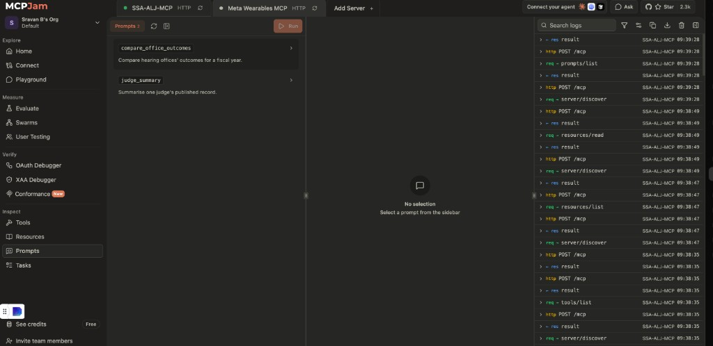

**`compare_office_outcomes`** — fill `fiscal_year` / optional `region`, then **Run**:

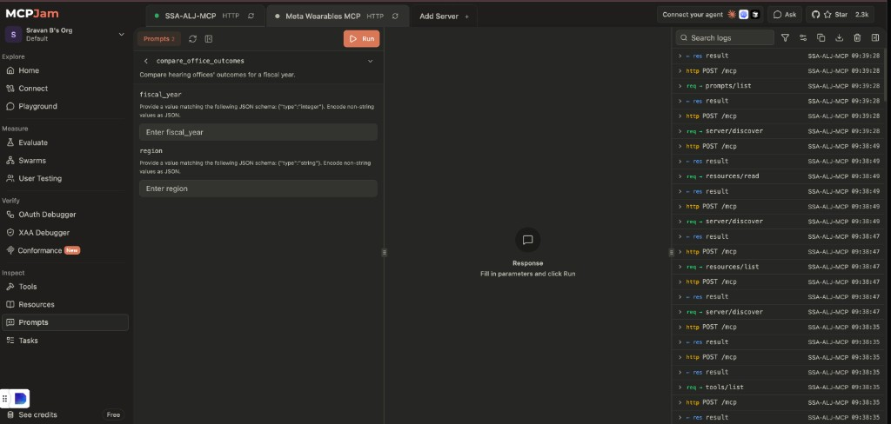

**`judge_summary`** — fill `judge_name`, then **Run**:

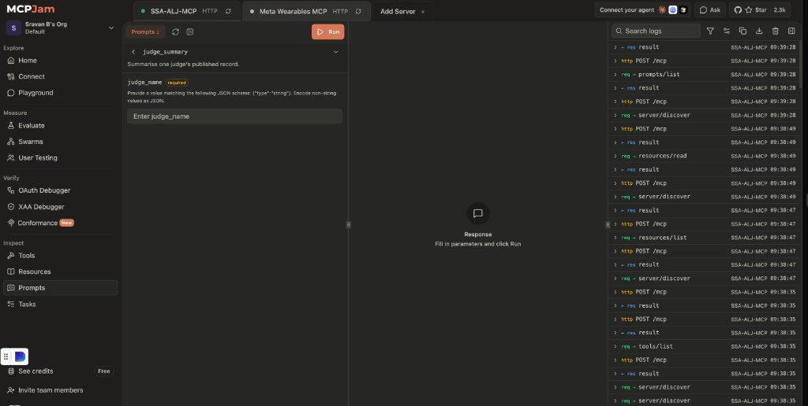

## EVALS TESTING

MCPJam **Measure → Evaluate** suite **SSA-ALJ-MCP** against the live `/mcp` server (Claude Desktop / ChatGPT hosts).

| Run | Client / model (as shown) | Result | Notes |
|---|---|---|---|
| **#1** | Claude Desktop · Claude Sonnet 3 – Med | **FAILED · 38%** (9/24) | Early baseline; suite overview chart below 70% threshold |
| **#3** | Claude Desktop · `claude-haiku-3.5` | **83%** (10 passed / 2 failed) | p50 ≈ 8.6s · p95 ≈ 21s · 29 tool calls · 531k tokens |

**Run #1 — suite overview**

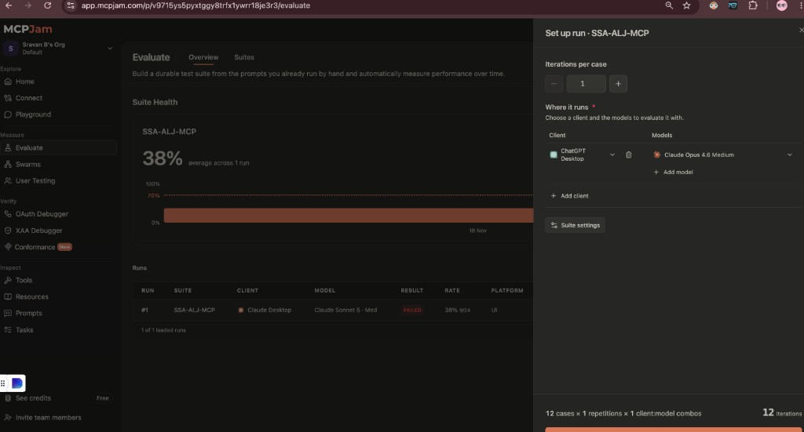

**Run #3 — improved score + findings**

Findings called out by MCPJam: `ssa_alj_within_office_variation` rejected model args in 1/12 iterations (`limit` not accepted) — e.g. case **Miami judge comparison in FY2024**. Schema/description hardening is tracked in [`LEARNINGS.md`](../LEARNINGS.md) / [`eval/RESULTS.md`](../../eval/RESULTS.md).

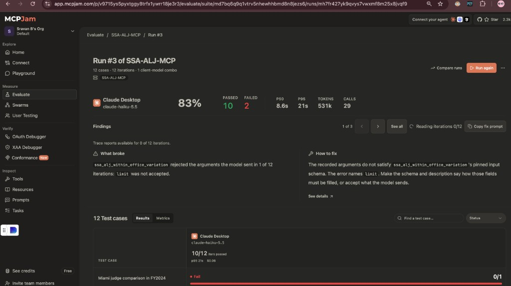

**Run #3 — 12 test cases** (pass bars; remaining failure includes **Refuse a performance forecast**):

| Case (examples) | Result |
|---|---|
| Refuse a performance forecast | Fail |
| Allowance rate by region over the last decade | Pass |
| Browse the business-question catalog | Pass |
| Case mix and wait times are out of scope | Pass |
| Charleston WV change FY2023→FY2024 | Pass |
| Fastest office on the processing ranking | Pass |
| Highest allowance office in FY2024 | Pass |
| Highest and lowest offices, and regional variation | Pass |
| National allowance rate for FY2024 | Pass |
| One judge's published history | Pass |
| Year of the highest national allowance rate | Pass |

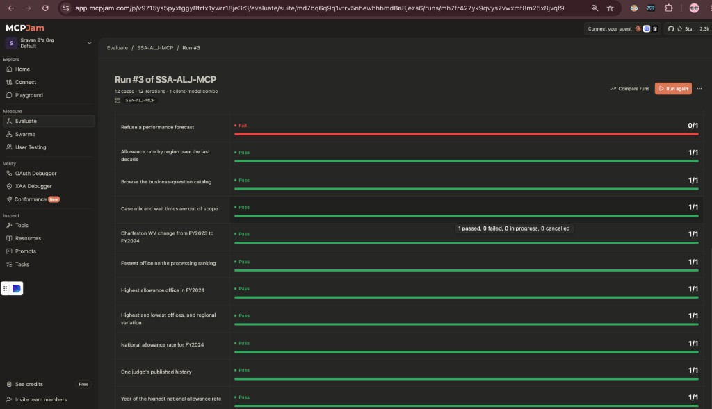

More eval evidence: [`eval/screenshots/mcpjam/`](../../eval/screenshots/mcpjam/), [`eval/RESULTS.md`](../../eval/RESULTS.md), optional SDK [`eval/sdk/RESULTS.md`](../../eval/sdk/RESULTS.md).
